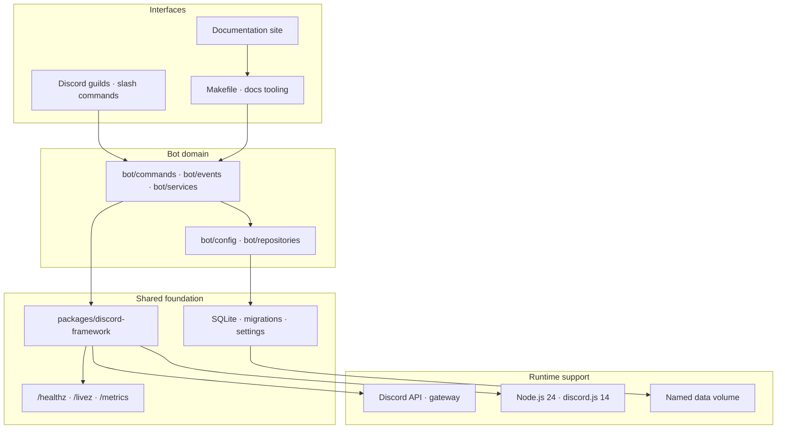

<div align="center">

<h1>Guild Bot Community</h1>

<p><strong>The open-source Discord bot for community guilds.</strong></p>

<p>Information, utility, help and configuration commands for your server. One bot, one shared framework, one image, one data volume — with least-privilege Discord intents and no moderation or message-content access.</p>

<p>
  <a href="https://learn.skygenesisenterprise.com">Documentation</a> ·
  <a href="https://github.com/skygenesisenterprise/discord-enterprise">Source</a> ·
  <a href="https://discord.gg/GUkDugVh34">Discord</a> ·
  <a href="https://github.com/skygenesisenterprise/discord-enterprise/issues">Issues</a>
</p>

<p>
  <a href="LICENSE"></a>
  <a href="https://nodejs.org"></a>
  <a href="https://pnpm.io"></a>
  <a href="https://discord.com/developers/docs"></a>
  <a href="https://discord.gg/GUkDugVh34"></a>
</p>

</div>

---

Guild Bot Community is the community bot distributed in this repository under
the `discord-enterprise` package name. It answers questions about your guild,
its members, roles and channels, exposes its own health and metrics endpoints,
and lets each server configure its locale, timezone, staff role and
announcements channel.

The bot is built on `@discord-enterprise/discord-framework`: a shared technical
foundation with **no bot business logic**. Commands, events, services and guild
settings belong to the bot; lifecycle, routing, permissions, storage and
observability belong to the framework. Run it from source or as the single
container defined by the root `Dockerfile` and `docker-compose.yml`.

## ✨ Highlights

- **Read-only by design.** The bot requests only the `Guilds` and `GuildMembers`
  intents. It reads no message content, runs no moderation and holds no voice
  state.
- **A catalogue you can inspect.** Every slash command has a contract: name,
  category, availability, permissions, cooldown and documentation metadata.
  `/help` explains each command from that same registry.
- **Fail-closed permissions.** Four layers — user permissions, bot permissions,
  business policy and registration hints — are rechecked on every interaction.
  A missing holder or a throwing policy is a denial.
- **Per-guild settings.** Locale (`fr`/`en`), IANA timezone, staff role,
  announcements channel and ephemeral replies are validated and stored in the
  bot's own SQLite database.
- **Safe interaction ids.** Buttons and context menus use versioned
  `discord-enterprise:v1:<namespace>:<action>[:<value>]` ids; malformed or
  unknown ids never reach a handler.
- **Observable.** `/healthz`, `/livez` and `/metrics` are served on a dedicated
  port, with structured JSON logs and token/secret redaction.
- **One image, one process, one volume.** No Redis, no PostgreSQL, no shared
  database. The container runs `index.js` and mounts a single data volume.
- **Open source.** MIT licensed, ESM JavaScript on Node.js 24, with a
  `node --test` suite that needs no install step for the framework.

## 📦 What's inside

| Product | What it does | Where |
| --- | --- | --- |
| **Community bot** | Slash commands, context menu, events, services, per-guild settings | [`bot/`](bot) |
| **Shared framework** | Lifecycle, command contract, routing, permissions, storage, settings, events, observability | [`packages/discord-framework/`](packages/discord-framework) |
| **Server package** | Platform domain and API support consumed by the documentation generators | [`packages/server/`](packages/server) |
| **Documentation site** | Fumadocs site with API and CLI references | [`docs/`](docs) |
| **Documentation tooling** | Spec validation, managed regions, link checks and generation | [`scripts/docs/`](scripts/docs) |
| **Docker stack** | Bot image, Compose service and container entrypoint | [`Dockerfile`](Dockerfile), [`docker-compose.yml`](docker-compose.yml), [`entrypoint.sh`](entrypoint.sh) |
| **Developer interface** | One `Makefile` over pnpm, Docker and the repository scripts | [`Makefile`](Makefile) |

## 🧱 Project support structure

The repository is organized as **support layers**. Each layer has one job and
depends only on the layer beneath it.



| Layer | Location | Owns | Depends on |
| --- | --- | --- | --- |
| **Interfaces** | `bot/commands`, `docs/`, `Makefile` | Discord surfaces, documentation, commands | Bot domain and tooling |
| **Bot domain** | `bot/` | Command catalogue, events, services, guild settings, tests | `@discord-enterprise/discord-framework` |
| **Shared foundation** | `packages/discord-framework/` | Lifecycle, routing, permissions, contracts, storage, observables | Discord peer dependencies |
| **Support packages** | `packages/server/` | Domain and API support for documentation generation | Runtime libraries only |
| **Tooling** | `scripts/`, `docker/`, `.github/` | Docs checks, installation helpers, CI | Repository tools |
| **Runtime** | `Dockerfile`, `docker-compose.yml`, `entrypoint.sh` | Image, service, data volume, healthcheck | Docker Engine with Compose |

### Repository map

```text
discord-enterprise/
├── bot/                          # @discord-enterprise/discord-enterprise
│   ├── commands/                 # Slash commands (about, help, config, …)
│   ├── config/                   # Bot constants and environment contract
│   ├── events/                   # clientReady, guildCreate, guildDelete
│   ├── migrations/               # Bot-owned SQLite migrations
│   ├── repositories/             # Guild event history
│   ├── services/                 # Help, info and status services
│   ├── test/                     # Bot tests (node --test)
│   ├── index.js                  # Process entrypoint
│   ├── deploy-commands.js        # Idempotent slash-command deployment
│   └── package.json              # Bot scripts and dependencies
├── packages/
│   ├── discord-framework/        # Shared runtime foundation, no business logic
│   └── server/                   # Platform domain and API support
├── docs/                         # @discord-enterprise/docs — Fumadocs site
├── scripts/docs/                 # Documentation checks and generators
├── scripts/                      # Worktree, ports and installation helpers
├── docker/                       # Deployment-tooling install helper
├── .github/                      # CI workflows, issue templates, labels
├── Dockerfile                    # Bot image, built from the repository root
├── entrypoint.sh                 # Data dir, command deployment, dev/prod start
├── docker-compose.yml            # One service, one volume, no database
├── Makefile                      # Thin wrapper over pnpm, Docker and scripts
├── .env.example                  # Root environment template
├── pnpm-workspace.yaml           # Workspace, catalog and dependency rules
└── README.md
```

### Dependency rules

1. The bot consumes `@discord-enterprise/discord-framework`; the framework never
   imports the bot.
2. Business rules live in `bot/`. The framework provides mechanisms, not
   guild-specific decisions.
3. Guild data stays in the bot's own SQLite file; no other product shares it.
4. The framework has no runtime dependency: `discord.js` and `@discordjs/voice`
   are peer dependencies, so its tests run with `node --test` and no install.
5. Secrets stay in `.env` files or the deployment secret store. Structured logs
   redact token and secret-shaped values.
6. The documentation site and the bot can be developed independently; only the
   docs generators consume `packages/server`.
7. The container mounts exactly one data volume and never mounts a Docker
   socket or a database service.

### Data ownership

| Store | Owner | Contents |
| --- | --- | --- |
| `bot/data/discord-enterprise.sqlite3` | Bot | Guild settings, guild join/leave history, migrations |
| `discord-enterprise-data` volume | Container | Same SQLite file, persisted across restarts |
| `bot/.env` | Operator | Discord token, application id, runtime settings |
| `.env` | Operator | Root template values, never committed |

## 🤖 Commands

| Category | Commands |
| --- | --- |
| Information | `/about`, `/docs`, `/help`, `/invite`, `/status`, `/support` |
| Guild | `/serverinfo`, `/channelinfo`, `/roleinfo`, `/membercount`, `/ping` |
| Members | `/avatar`, `/userinfo`, **User information** context menu |
| Configuration | `/language`, `/config` (`view`, `set`, `reset`) |

`/config set` accepts `locale`, `timezone`, `staff-role`, `announcements-channel`
and `ephemeral`; `/config reset` restores the defaults. Commands available only
in a guild are rejected in DMs, and staff-only settings are fail-closed.

## 🧰 Technology

| Area | Stack |
| --- | --- |
| Bot | ESM JavaScript, Node.js 24, discord.js 14, dotenv |
| Framework | Peer-only dependencies, injectable side effects, versioned contracts |
| Storage | SQLite with checksummed migrations, paginated repositories |
| Configuration | Schema-driven environment parsing with defaults and warnings |
| Observability | `/healthz`, `/livez`, `/metrics`, structured redacted JSON logs |
| Deployment | Docker, Docker Compose, Docker Buildx, GHCR images |
| Documentation | Next.js 16, Fumadocs, Tailwind CSS 4 |
| Quality | `node --test`, Biome checks, documentation spec/link checks |

## ⚡ Quick start

### Prerequisites

- **Node.js 24.4+** (`.nvmrc` pins `24.4.0`) and **pnpm 12**
  (`packageManager` pins `12.16.1`) for development
- **Docker Engine** with the Compose plugin to run the container
- A **Discord application and bot token**, with the `Guilds` and `GuildMembers`
  intents enabled

### Run with Docker

```bash
git clone https://github.com/skygenesisenterprise/discord-enterprise.git
cd discord-enterprise
cp bot/.env.example bot/.env
```

Fill in `DISCORD_TOKEN`, `DISCORD_APPLICATION_ID` and, for guild-scoped command
deployment, `DISCORD_GUILD_ID`. Then:

```bash
make docker-up
make docker-logs
```

`make install` creates `bot/.env` from the template if it is missing, then runs
the same stack. The Compose service publishes the health port `3010` and mounts
the named volume `discord-enterprise-data` at `/app/bot/data`.

| Endpoint | URL |
| --- | --- |
| Health | [http://localhost:3010/healthz](http://localhost:3010/healthz) |
| Liveness | [http://localhost:3010/livez](http://localhost:3010/livez) |
| Metrics | [http://localhost:3010/metrics](http://localhost:3010/metrics) |

To register slash commands, set `DISCORD_ENTERPRISE_DEPLOY_COMMANDS=true` for one
start, or run `node deploy-commands.js` from `bot/` once its dependencies are
installed. Deployment is idempotent and validated by the framework.

```bash
make docker-ps
make docker-down     # keeps the data volume
```

## 🛠️ Development

```bash
make deps            # pnpm install
make test            # framework + documentation tooling tests
make lint            # Biome checks
```

| Command | What it runs |
| --- | --- |
| `make deps` | Install the workspace dependencies |
| `make test` | Framework tests and documentation tooling tests |
| `make test-framework` | `packages/discord-framework/test/` with `node --test` |
| `make test-docs` | `scripts/docs/tests/` with `node --test` |
| `make test-bot` | `bot/test/` (requires the bot's own dependencies) |
| `make lint` | Recursive workspace lint |
| `make docs-dev` / `make docs-build` | Documentation site |
| `make docs-check` / `make docs-generate` | Validate / regenerate managed docs |

The framework suite needs no install step; the documentation tests need the root
dependencies from `make deps`. The bot is a standalone package with its own
`package.json`.

### Working on the bot

```bash
node --disable-warning=ExperimentalWarning --test packages/discord-framework/test/*.test.js
cd bot && node --disable-warning=ExperimentalWarning --test test/*.test.js
```

The bot entrypoint is `bot/index.js`; its configuration schema is in
`bot/config/env.js`. New commands should use `defineCommand` from the framework
and be placed in `bot/commands/`.

### Working on the documentation

```bash
make docs-check
make docs-generate
make docs-dev       # http://localhost:3001
```

The docs CLI validates specs, managed regions and links against the
implementation; see [`scripts/docs/`](scripts/docs).

## 🚀 Deployment

### Image

| Product | Image |
| --- | --- |
| Guild Bot Community | `ghcr.io/skygenesisenterprise/discord-enterprise` |

The root `Dockerfile` builds from the repository root: it copies `bot/` to
`/app/bot/` and `packages/discord-framework/` to `/app/packages/discord-framework/`,
fixes the local framework dependency path, installs production dependencies and
links peer resolution to the bot's `node_modules`. `entrypoint.sh` prepares the
data directory, optionally deploys commands, then `exec`s the bot.

```bash
make image-build     # tags: v<version>, sha-<sha>, latest
make image-pull      # pull the published image
make image-push      # push the local tags (docker login first)
```

### Configuration

| Scope | Template | Required values |
| --- | --- | --- |
| Bot | `bot/.env.example` | `DISCORD_TOKEN`, `DISCORD_APPLICATION_ID` |
| Container | `docker-compose.yml` | `DISCORD_ENTERPRISE_HEALTH_PORT`, optional image overrides |

| Variable | Purpose |
| --- | --- |
| `DISCORD_TOKEN` / `DISCORD_APPLICATION_ID` | Bot credentials |
| `DISCORD_GUILD_ID` | Guild used for scoped command deployment |
| `DISCORD_ENTERPRISE_GUILD_DISCORD_TOKEN` etc. | Per-bot framework credential variables |
| `DISCORD_ENTERPRISE_COMMAND_SCOPE` / `DISCORD_ENTERPRISE_COMMAND_GUILD_ID` | Global, guild or no command deployment |
| `DISCORD_ENTERPRISE_LOG_LEVEL` | `debug`, `info`, `warn` or `error` |
| `DISCORD_ENTERPRISE_DATA_DIR` / `DISCORD_ENTERPRISE_DATABASE_PATH` | SQLite location inside the container |
| `DISCORD_ENTERPRISE_HEALTH_PORT` | Health and metrics port (default `3010`) |
| `DISCORD_ENTERPRISE_DEPLOY_COMMANDS` | Deploy slash commands at startup |
| `DISCORD_ENTERPRISE_DOCS_URL` / `DISCORD_ENTERPRISE_SUPPORT_URL` | Links used in `/docs` and `/support` |

Secrets belong only in `.env` files or the deployment secret store; they are
never committed.

## 📈 Operations

- **Health checks** — `/healthz` and `/livez` on the configured health port;
  Compose also runs a container healthcheck.
- **Metrics** — Prometheus-style counters, gauges and histograms on `/metrics`.
- **Logs** — `make docker-logs` follows structured JSON output with redaction.
- **State** — `make docker-down` preserves `discord-enterprise-data`; remove the
  volume only when you intend to lose guild settings and history.
- **Updates** — `make update` pulls the revision and restarts the bot.
- **Checks** — `make doctor` verifies Docker, Compose, the stack files and
  `bot/.env`.
- **Help** — `make help` lists every available target.

```bash
make doctor
make docker-ps
make docker-logs
```

## 📚 Documentation and support

| Resource | Link |
| --- | --- |
| Documentation | [docs.discord-enterprise.com](https://docs.discord-enterprise.com) |
| Source | [skygenesisenterprise/discord-enterprise](https://github.com/skygenesisenterprise/discord-enterprise) |
| Community | [Discord](https://discord.gg/GUkDugVh34) |
| Bugs and requests | [GitHub Issues](https://github.com/skygenesisenterprise/discord-enterprise/issues) |
| Shared framework | [`packages/discord-framework`](packages/discord-framework) |
| Commercial support | [Sky Genesis Enterprise](https://skygenesisenterprise.com) |

### Common questions

| Question | Answer |
| --- | --- |
| Is the bot free? | Yes. The repository is MIT licensed. |
| Does it need a database server? | No. It uses a SQLite file inside its own data volume. |
| What permissions does it request? | `Guilds` and `GuildMembers` only — no message content, no moderation, no voice state. |
| Which languages does it support? | French and English for the bot interface, configured per guild. |
| How do I deploy slash commands? | Enable `DISCORD_ENTERPRISE_DEPLOY_COMMANDS` for one start, or run `bot/deploy-commands.js`. |
| Where do I get help? | Ask on [Discord](https://discord.gg/GUkDugVh34) or open a [GitHub issue](https://github.com/skygenesisenterprise/discord-enterprise/issues). Never report a vulnerability in a public issue. |

### Common checks

| Symptom | First place to look |
| --- | --- |
| The bot does not connect | `DISCORD_TOKEN` and `DISCORD_APPLICATION_ID` in `bot/.env` |
| Slash commands are missing | Command scope, or `DISCORD_ENTERPRISE_DEPLOY_COMMANDS` was never enabled |
| Settings are lost after restart | The `discord-enterprise-data` volume was removed |
| `/help` looks outdated | Deploy the commands again after changing a definition |
| A framework test fails after a rename | Update the expected env names and metric prefixes together |

## 🤝 Contributing

Contributions are welcome. Read the [Code of Conduct](CODE_OF_CONDUCT.md) and the
[contribution guide](.github/CONTRIBUTING.md), keep pull request titles in
Conventional Commits format, and add a changeset for user-facing changes.

```bash
make test
make lint
make docs-check
```

Never paste tokens, credentials or guild data into an issue or pull request.

## 🔒 Security

Do not report vulnerabilities in public issues. Follow the private reporting
instructions in [`SECURITY.md`](SECURITY.md).

## 📄 License

This repository is licensed under the [MIT License](LICENSE).

---

<div align="center">

Maintained by [Sky Genesis Enterprise](https://skygenesisenterprise.com).

</div>
